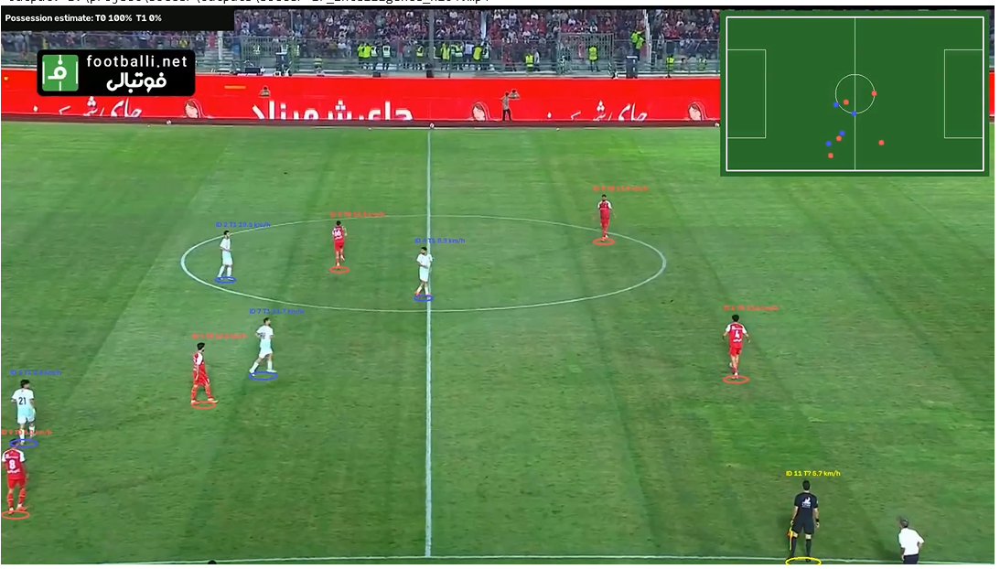
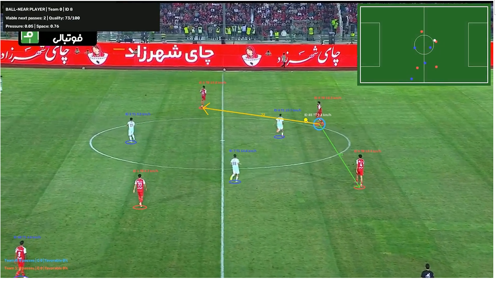
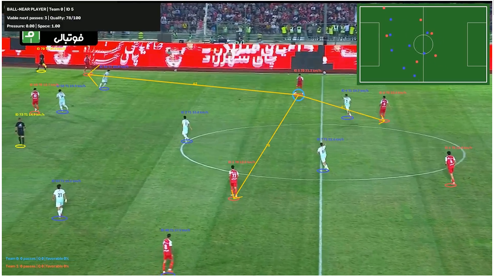

# Soccer-Match-Intelligence-and-pass-analysis
**AI-powered football video analytics: YOLO detection, multi-object tracking, team recognition, 2D pitch mapping, player speed, estimated possession, and tactical pass analysis.**

   

> **Research prototype:** Outputs such as player speeds, possession percentages, candidate passes, and passing quality are estimates, not independently validated official match statistics. Processing is offline by default; it is not guaranteed real-time, particularly on CPU.

## 🎯Overview

`Soccer_Match_Intelligence.ipynb` transforms broadcast-style football footage into an annotated video and structured CSV datasets. It combines pretrained football-specific YOLO models with ByteTrack, jersey-color clustering, pitch keypoint geometry, homography, and rule-based tactical analysis. **No training from scratch is required to run the supplied inference pipeline.**

## Results / Screenshots

### Detection and tracking



### Pass analysis — view 1



### Pass analysis — view 2



## Key features

| Capability | Implementation | Output / benefit |
| --- | --- | --- |
| Player / goalkeeper / referee detection | Football-specific YOLO detection model | Bounding boxes and class labels |
| Persistent player tracking | Ultralytics `track(..., tracker='bytetrack.yaml', persist=True)` | Track IDs across frames |
| Team identification | Torso jersey-color descriptors and clustering | Team 0 / Team 1; uncertain identities can remain unknown |
| Pitch landmarks | YOLO pose model with 32 pitch landmarks | Camera-to-pitch correspondence |
| Bird's-eye radar | RANSAC homography + pitch coordinates | Approximate player positions on a 2D pitch |
| Player speed | Frame-to-frame metric position changes with smoothing | Approximate km/h per tracked player |
| Ball localization | Separate football-specific YOLO ball model | Ball observations for possession and passes |
| Ball possession | Nearest-player association with short-gap handling | Estimated team possession percentages |
| Candidate pass detection | Stable ball ownership changes between same-team players | Candidate passer, receiver, distance, and transfer time |
| Passing options | Distance, free space, passing-lane clearance, progression | Ranked receiver options and heuristic quality score |
| Tactical overlays | OpenCV rendering | Passing arrows, pressure/space metrics, and team summaries |
| Export | OpenCV, pandas, FFmpeg | Annotated MP4s and CSV tables |

**Team IDs are arbitrary cluster labels, not actual club names.** The notebook uses detection class IDs from the loaded player checkpoint rather than assuming all YOLO models share the same class map.

## Pipeline

```text
Input match video
       |
       +--> YOLO player detector --> ByteTrack IDs --> jersey-color team clustering
       |                                  |
       |                                  +--> tracked player positions
       |
       +--> YOLO pitch pose model --> 32 landmarks --> homography --> 2D pitch coordinates
       |                                                        |
       |                                                        +--> speed estimates / radar
       |
       +--> YOLO ball detector --> ball-to-player association --> possession estimate
                                                                  |
                                                                  +--> stable ownership changes
                                                                            |
                                                                            +--> candidate passes
                                                                                      |
                                                                                      +--> receiver options
                                                                                      +--> pressure / open space
                                                                                      +--> heuristic pass quality
                                                                                      +--> tactical video + CSV
```

## Requirements

- Python 3.10+ recommended; Jupyter Notebook or JupyterLab.
- CPU is supported (`DEVICE='cpu'` in the notebook); GPU acceleration requires a compatible PyTorch installation and changing the device configuration.
- Sufficient disk space for three checkpoints, source video, and rendered outputs.
- An internet connection for the first model download.

Install dependencies manually, if preferred:

```bash
python -m pip install "ultralytics>=8.3" "supervision>=0.25" "opencv-python>=4.8" "numpy<3" pandas scikit-learn matplotlib gdown tqdm ipython imageio-ffmpeg jupyter
```

The first notebook cells also install these packages automatically.

## Quick start

1. Clone/download this repository and open `Soccer_Match_Intelligence.ipynb` in Jupyter.
2. Place a football video named `soccer-ir.mp4` in the project root, **or** edit `SOURCE` in the configuration cell.
3. Run the cells **in order**, including package installation and model download.
4. Find annotated videos and CSV data in `outputs/`.

```bash
jupyter notebook Soccer_Match_Intelligence.ipynb
```

The default configuration processes at most **450 frames** in the first tracking stage (`MAX_FRAMES=450`). Increase this for longer analysis. The later pass-analysis stage uses the generated tracking CSV and can have its own frame limit; ensure the available tracking records cover the intended analysis interval.

### Main configuration

```python
SOURCE = 'soccer-ir.mp4'
DEVICE = 'cpu'
IMG_SIZE = 640
BALL_SIZE = 640
PITCH_SIZE = 640
PITCH_EVERY = 20
BALL_EVERY = 3
MAX_FRAMES = 450
SHOW_LIVE = False
LIVE_EVERY = 15
```

`SHOW_LIVE=True` refreshes notebook previews but may reduce throughput. `PITCH_EVERY` and `BALL_EVERY` control how often the corresponding models run in the first stage. Other thresholds and analysis parameters are defined in the later cells.

## Downloading pretrained `.pt` models

This notebook uses **three football-specific checkpoints**, not generic object-detection weights:

| Local checkpoint | Role |
| --- | --- |
| `models/football-player-detection.pt` | Detect football players, goalkeepers, and referees |
| `models/football-ball-detection.pt` | Detect the football |
| `models/football-pitch-detection.pt` | Predict pitch landmarks (**pose task**) |

### Option A — automatic (recommended)

Run the notebook's model setup cell. It creates `models/`, downloads any missing/suspiciously small files with `gdown`, then loads the three checkpoints using `ultralytics.YOLO`:

```python
from pathlib import Path
import gdown
from ultralytics import YOLO

MODELS = Path('models')
MODELS.mkdir(exist_ok=True)

MODEL_IDS = {
    'football-player-detection.pt': '17PXFNlx-jI7VjVo_vQnB1sONjRyvoB-q',
    'football-ball-detection.pt': '1isw4wx-MK9h9LMr36VvIWlJD6ppUvw7V',
    'football-pitch-detection.pt': '1Ma5Kt86tgpdjCTKfum79YMgNnSjcoOyf',
}

for filename, file_id in MODEL_IDS.items():
    path = MODELS / filename
    if not path.exists() or path.stat().st_size < 1_000_000:
        gdown.download(id=file_id, output=str(path), quiet=False)

player_model = YOLO(str(MODELS / 'football-player-detection.pt'))
ball_model = YOLO(str(MODELS / 'football-ball-detection.pt'))
pitch_model = YOLO(str(MODELS / 'football-pitch-detection.pt'))
assert pitch_model.task == 'pose', 'Expected pitch keypoint/pose weights'
```

**Checkpoint provenance:** The notebook contains Google Drive IDs but does not itself establish the uploader, model version, license, or official origin of those files. Review their provenance and usage rights before redistributing weights or describing them as officially published. The notebook's comment refers to an “official setup.sh,” but that script is **not included in this notebook**.

### Option B — download models manually from official project sources

- **Ultralytics:** [Ultralytics documentation](https://docs.ultralytics.com/) and [official Ultralytics GitHub](https://github.com/ultralytics/ultralytics) explain how to obtain and use general YOLO checkpoints. For example, `YOLO('yolo11n.pt')` can automatically retrieve a standard model, but **that is not a drop-in replacement** for all three football-specific checkpoints, especially the 32-landmark pitch pose model.
- **Roboflow Sports:** [Official Roboflow Sports repository](https://github.com/roboflow/sports) contains football computer-vision examples and model setup guidance. Consult its current instructions and verify model compatibility, provenance, and licensing before substituting weights.

For manual installation, save compatible checkpoints with the **exact three filenames above** inside `models/`; the notebook skips downloading existing files larger than its minimum-size check. A model must match the expected task, class mapping, and (for pitch detection) landmark order. Generic YOLO weights alone cannot reproduce the full pipeline.

## Output files

The notebook writes the following paths:

```text
outputs/
├── soccer-ir_intelligence.mp4               # Detection/tracking/radar video
├── soccer-ir_intelligence_h264.mp4          # Browser-friendly H.264 version
├── player_tracking-ir.csv                  # Per-frame player tracking and positions
├── soccer-ir_pass_main_camera.mp4          # Tactical pass overlay
├── soccer-ir_pass_main_camera_h264.mp4     # Browser-friendly tactical video
├── candidate_passes_v4.csv                 # Candidate pass events
├── team_pass_stats_v4.csv                  # Aggregated team pass statistics
├── receiver_options_v4.csv                # Ranked receiver options
└── ball_observations_v4.csv               # Ball observations and owner association
```

Output filenames are hard-coded in notebook cells and can be changed there. H.264 conversion uses `imageio-ffmpeg` to improve browser and Jupyter playback compatibility.

### Data fields

- **Player tracking:** frame, timestamp, track ID, class, team, image-space foot coordinates, mapped pitch coordinates (`x_m`, `y_m`), and estimated speed (`speed_kmh`).
- **Candidate passes:** passer/receiver IDs, team, frame/time, estimated pass distance and transfer time, quality, favorable flag, receiver-option counts, pressure, and open-space indicators.
- **Team statistics:** candidate pass count, average heuristic quality, percentage flagged favorable, and average viable options.
- **Receiver options:** candidate receiver IDs, heuristic scores, and passing-lane metrics.

## How pass quality is computed

The notebook uses an **interpretable hand-crafted heuristic**, not a supervised model trained on expert-labeled pass outcomes. For each receiving player, it examines nearby teammates and opponents in mapped pitch coordinates, considering:

- **Space:** separation from the nearest opponent.
- **Lane clearance:** proximity of opponents to the candidate pass segment.
- **Progression:** movement toward the assumed attacking direction.
- **Pass length:** a distance-based suitability term.
- **Pressure and choice:** the receiver's local pressure and the availability of viable subsequent passes.

It combines these terms into scores, filters candidate options using thresholds, and reports a quality value on a 0–100 scale. **This score is a heuristic indicator, not a calibrated probability of pass success.**

**Important:** Check and set `ATTACK_DIRECTION` in the pass-analysis configuration for the footage. An incorrect attacking direction changes progression and therefore quality scores.

## Technical notes and limitations

- Team 0 and Team 1 are determined from jersey colors and may be unreliable under occlusion, lighting changes, or similar kits; goalkeeper assignment may require manual configuration (`GOALKEEPER_TEAM`).
- Homography depends on visible, correctly localized pitch landmarks. Camera cuts, zooms, and perspective changes can affect position and speed estimates.
- Ball detection is challenging because the ball is small and often occluded. Ownership uses proximity and stability thresholds; inferred possession and passes can be missed or falsely assigned.
- Candidate passes are inferred from same-team ownership transitions with distance/time constraints; the pipeline does **not** independently establish a ground-truth completed pass or recognize every type of ball action.
- Player speeds are smoothed estimates derived from pitch mapping, not GPS measurements.
- Results depend on resolution, broadcast camera angle, frame rate, inference hardware, and configured thresholds.
- CPU inference is supported but may be slow. **Real-time operation has not been established by the notebook.**
- The pipeline does not include a formal accuracy benchmark or labeled evaluation set. Avoid presenting numerical accuracy claims without separate validation.

## Suggested repository structure

```text
Soccer-Match-Intelligence/
├── README.md
├── Soccer_Match_Intelligence.ipynb
├── soccer-ir.mp4                    # Your own sample video (optional)
├── models/                         # Downloaded .pt files (often excluded from Git)
└── output/
```
## Potential applications

- Football computer-vision research and prototyping.
- Video-based player movement exploration.
- Visual inspection of candidate passing events and tactical space.
- Building structured datasets for downstream football analytics.
- Extending the system with calibrated tracking, evaluation benchmarks, event recognition, or learned tactical models.

## Future improvements

- Benchmark detection, tracking, team assignment, and event detection against annotated ground truth.
- Add camera-cut detection and robust per-segment pitch calibration.
- Improve ball tracking under occlusion and fast motion.
- Evaluate more efficient inference and hardware acceleration for live streams.
- Replace heuristic pass quality with a validated predictive model.
- Add interactive analytics dashboards, per-player statistics, and exportable pitch heatmaps.

## Acknowledgments

Built with [Ultralytics](https://github.com/ultralytics/ultralytics), [OpenCV](https://opencv.org/), [scikit-learn](https://scikit-learn.org/), and [Roboflow Sports](https://github.com/roboflow/sports) ecosystem concepts. Check the applicable licenses of software, pretrained models, and videos before reuse or distribution.

## 💡 Final Note

Thank you for checking out the Kringloop ERP Demo project.  
I hope you enjoy exploring the system and its features. ♻️✨
Feel free to contribute, improve, or use it as inspiration for your own projects.
